<p align="center">
  
</p>

<p align="center">
  <b>A local voice for your AI agent.</b><br>
  Talk to it. It talks back, searches the web, opens pages on your screen, and reads your notes.
</p>

<p align="center">
  <a href="https://orbitvox.github.io/">Website</a> ·
  <a href="#quick-start">Quick start</a> ·
  <a href="SECURITY.md">Security model</a> ·
  <a href="CHANGELOG.md">Changelog</a>
</p>

<p align="center">
  
  
  
  
</p>

---

OrbitVox gives an AI agent a voice on your own PC. Speech-to-text (Whisper) and the voice (Kokoro) both run locally, so your audio never leaves the machine. Only the words go to the brain you pick: your own Claude Code login, an OpenRouter key, or a local model through Ollama or LM Studio. While it listens and speaks, an orb page at `localhost:8765` pulses with its voice.

```
mic ──▶ Whisper (local) ──▶ your brain ──▶ Kokoro (local) ──▶ speakers
                                                         └──▶ orb page, live
```

## Talk to it

With the Claude brain:

| You say | It does |
|---|---|
| “What’s the weather in Paris?” | Searches the web and answers out loud. |
| “Show me pictures of owls on Google.” | Opens Google Images in your browser. |
| “In your own browser, play a cat video on YouTube.” | Opens a separate Edge window. You watch it search, click and play. The mic mutes itself while the video runs. |
| “Vault mode.” then “What did I write about the launch?” | Reads your notes folder, read-only. |
| “Web mode.” | Back to the web. |

Press <kbd>M</kbd> in the console to mute or unmute the mic.

## Quick start

You need [Python 3.13](https://www.python.org/downloads/) and [Node.js 18+](https://nodejs.org/). For the Claude brain, you also need [Claude Code](https://docs.claude.com/en/docs/claude-code) logged in with **your own** account (run `claude` once).

```powershell
git clone https://github.com/orbitvox/orbitvox
cd orbitvox
py -3.13 -m venv .venv
.\.venv\Scripts\pip install -r requirements.txt
.\.venv\Scripts\python get_models.py          # Kokoro voice model, ~115 MB, checksum-verified
cd browser; npm ci --ignore-scripts; cd ..     # its own browser (Playwright MCP, pinned)
copy .env.example .env
.\.venv\Scripts\python bot.py
```

Wait for `Claude: ready`, open http://localhost:8765, and say hello. On the first run, Whisper downloads its speech model (about 480 MB) from Hugging Face.

`get_models.py` checks the Kokoro files against SHA-256 values in `models/SHA256SUMS.txt`. The upstream release publishes no checksums, so those values come from our own first download: they catch a file that changes later, not one that was bad from the start.

To check the install without a mic or network, run `.\.venv\Scripts\python check_offline.py`. Kokoro speaks a sentence and Whisper hears it back.

## Pick a brain

| `BRAIN=` | Web, links, own browser | Notes (vault) | Runs on | Costs |
|---|:-:|:-:|---|---|
| `claude` | yes | yes | Anthropic, your Claude Code login | Your plan’s limits |
| `openrouter` | — | — | OpenRouter, your API key | Per token |
| `openai` | — | — | Any OpenAI-compatible server, e.g. Ollama or LM Studio | Free when local |

With the Claude brain, the first word arrives in about 1 second.

With `openai`, everything you say, and the key, is sent to `OPENAI_BASE_URL`. OrbitVox prints that host at start-up and refuses plain `http://` unless it points at this computer or your local network.

## Make it yours

Everything personal lives in two files that are never committed: `.env` and `persona.txt`.

| Setting | What it changes |
|---|---|
| `persona.txt` | Who it is, in plain words. Start from `persona.example.txt`. |
| `ASSISTANT_NAME` | Its name. |
| `USER_TITLE` | How it addresses you in its own lines, e.g. `Boss`. |
| `ORB_LOGO` | Your own SVG for the orb page. Elements with class `spin` or `spinr` rotate faster as it speaks; the last `.pulse` swells. Use only SVGs you trust. |
| `VOICE` | A Kokoro voice: `bm_george`, `bm_lewis`, `af_heart` and more. |
| `VAULT_DIR` | A notes folder for vault mode, such as an Obsidian vault. Blank turns vault mode off. |

All options are listed in [`.env.example`](.env.example).

## Security model

The assistant has real powers, so they're limited by the brain's **launch flags**, not only by prompts. A web page can talk a model out of a prompt rule; it can't change the flags.

- **Two modes, never at once.** Vault mode can read your notes and nothing else. Web mode has search, links and its own browser, and no notes. A switch restarts the brain, so nothing read in one mode carries into the other.
- **Only what the mic hears switches modes**, never text on a page or the model's own reply. Sound from your speakers reaches the mic too, so use headphones, or press <kbd>M</kbd> to mute it.
- **Notes are read-only.** There are no write, edit or shell tools. Reads outside the folder are refused, and so are `.env*`, `.git`, `.ssh`, `.claude` and `.obsidian` inside it. These limits come from Claude Code's own permission rules; they're tested on Windows, so re-test them after a Claude Code update.
- **Links on your screen** must be `https`, with no IPs, local hosts, odd ports or direct downloads. Google, YouTube, Wikipedia and GitHub open at once, except redirect and download links on them; anything else waits for your “yes”.
- **Its own browser** is [Playwright MCP](https://github.com/microsoft/playwright-mcp), pinned to an exact version, with a throwaway profile and none of your logins. It can navigate, click, type and take screenshots, so it could fill a form field by field. It can't run scripts on a page, upload files or use the one-step form-fill tool.
- **Account.** `ANTHROPIC_*` and `CLAUDE_*` variables are removed before the Claude CLI starts, so an API key in your environment is never picked up by accident. It uses whichever account the CLI is logged in to. OrbitVox never reads your login.
- **Orb page.** It's served on `127.0.0.1` only and refuses requests for any other host name.
- **Log.** Every tool call and every link opened goes to `logs/orbitvox.log`.

Found a hole? Report it privately: see [SECURITY.md](SECURITY.md).

## Limits

- Windows first. The mute key and the path handling are Windows-only for now; Mac and Linux pull requests are welcome.
- English only, using Whisper `small`.
- You can't talk over it; it listens again when it stops speaking.
- The `openrouter` and `openai` brains are plain chat, with no web, browser or notes.
- The Claude brain runs the official Claude Code CLI headless, under your own login, for your personal use. It counts against your account's limits. Anthropic's terms on automated use may not allow this for every account, so check them. Never run OrbitVox as a service for other people on your login.

## Built with

[pipecat](https://github.com/pipecat-ai/pipecat) · [faster-whisper](https://github.com/SYSTRAN/faster-whisper) · [Kokoro ONNX](https://github.com/thewh1teagle/kokoro-onnx) · [Playwright MCP](https://github.com/microsoft/playwright-mcp) · [Claude Code](https://docs.claude.com/en/docs/claude-code)

## Licences and trademarks

OrbitVox's own code is MIT. It installs, but doesn't ship, packages under their own licences: pipecat (BSD-2-Clause), faster-whisper (MIT), kokoro-onnx (MIT), the Kokoro model (Apache-2.0) and Playwright MCP (Apache-2.0). The Kokoro chain also pulls in espeak-ng (GPL-3.0). Check each licence if you redistribute a bundle.

OrbitVox is an independent project. It isn't affiliated with or endorsed by Anthropic, Microsoft, OpenRouter or Daily. Claude, Claude Code, Edge, Playwright and the other names are trademarks of their owners.

## Contributing

Small, tested pull requests are welcome. Read [CONTRIBUTING.md](CONTRIBUTING.md) and the [code of conduct](CODE_OF_CONDUCT.md) first.

---

<p align="center"><sub>MIT licence · made by Adonis_Helix</sub></p>
